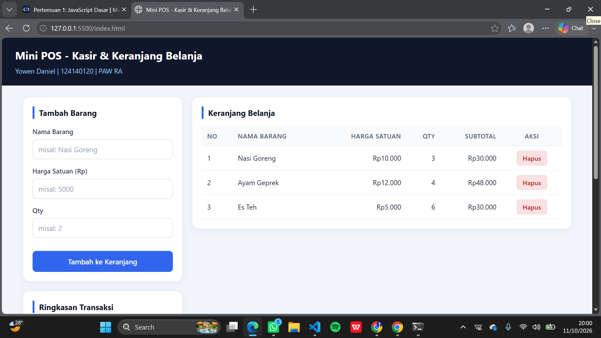
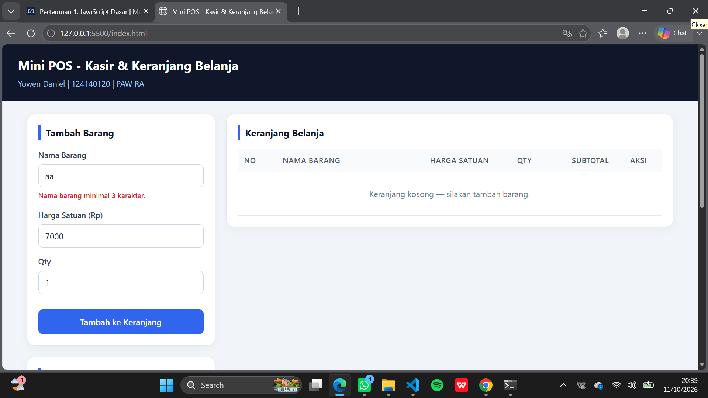
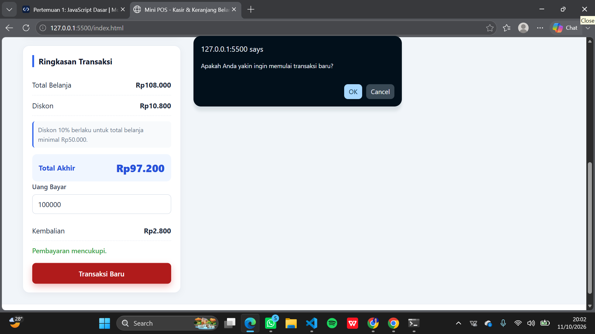

# Mini POS – Aplikasi Kasir & Keranjang Belanja

## Identitas

- Nama: Yowen Daniel
- NIM: 124140120
- Kelas: PAW RA

## Deskripsi Aplikasi

Mini POS adalah aplikasi kasir (Point of Sale) sederhana berbasis web untuk membantu kasir kantin atau toko kampus. Aplikasi ini dapat memasukkan barang baru ke dalam keranjang belanja, menampilkan tabel keranjang, menghitung subtotal setiap barang, menghitung total belanja, memberikan diskon otomatis 10% untuk transaksi minimal Rp50.000, menghitung total akhir, menerima input uang bayar, dan menghitung kembalian. Seluruh isi keranjang disimpan di `localStorage` sehingga data tetap ada meskipun halaman di-refresh.

Dibuat dengan HTML5, CSS3, dan JavaScript Vanilla tanpa menggunakan framework apa pun.

## Tujuan

Aplikasi ini dibuat untuk tugas praktikum Pemrograman Web dengan tujuan menerapkan kompetensi berikut:

- **Validasi form** – memastikan input nama barang, harga, dan qty benar sebelum masuk keranjang
- **Kalkulator otomatis** – menghitung subtotal, total belanja, diskon, total akhir, dan kembalian secara otomatis
- **Array/list** – menyimpan daftar barang di keranjang menggunakan array JavaScript
- **localStorage** – menyimpan keranjang agar data tidak hilang saat halaman di-refresh
- **JSON.stringify()** – mengubah array keranjang menjadi string sebelum disimpan ke localStorage
- **JSON.parse()** – mengubah data string dari localStorage kembali menjadi array

## Fitur

- [x] Validasi nama barang minimal 3 karakter
- [x] Validasi harga minimal Rp500
- [x] Validasi harga harus positif
- [x] Validasi qty minimal 1
- [x] Tambah barang ke keranjang
- [x] Menampilkan tabel keranjang
- [x] Perhitungan subtotal
- [x] Perhitungan total belanja
- [x] Diskon 10% untuk transaksi minimal Rp50.000
- [x] Perhitungan total akhir
- [x] Input uang bayar
- [x] Perhitungan kembalian
- [x] Pesan jika uang tidak mencukupi
- [x] Hapus item
- [x] Penyimpanan localStorage
- [x] JSON.stringify()
- [x] JSON.parse()
- [x] Transaksi baru/reset
- [x] Responsive design

## Struktur Folder

```
YowenDaniel_124140120_pertemuan1/
│
├── index.html      ← struktur halaman
├── style.css       ← tampilan / desain
├── script.js       ← logika aplikasi (validasi, kalkulator, localStorage)
├── README.md       ← dokumentasi (file ini)
│
└── modul/
    └── README.md   ← keterangan folder modul
```

## Panduan Menjalankan

1. Clone/download repository ini
2. Buka folder project di VS Code
3. Buka `index.html` menggunakan **Live Server** (klik kanan pada `index.html` → *Open with Live Server*)
4. Aplikasi akan terbuka di browser

Jika tidak menggunakan Live Server, `index.html` juga dapat dibuka langsung di browser (double-click file `index.html`). Aplikasi tetap berjalan karena tidak memerlukan server/backend.

## Penjelasan Teknis

### Validasi

Validasi dilakukan dengan JavaScript pada fungsi `validateForm()` yang dipanggil setiap kali form di-submit, bukan hanya mengandalkan atribut HTML.

- **Nama Barang**: wajib diisi dan minimal 3 karakter. Jika kosong atau kurang dari 3 karakter, muncul pesan error merah tepat di bawah input.
- **Harga Satuan**: wajib diisi, harus berupa angka, tidak boleh negatif, tidak boleh 0, dan minimal Rp500. Pesan error berbeda ditampilkan untuk setiap kesalahan.
- **Qty**: wajib diisi, harus berupa angka bulat, dan minimal 1.

Jika ada satu saja kesalahan, barang **tidak** masuk ke keranjang, pesan error ditampilkan, dan form **tidak** di-reset. Jika semua valid, barang masuk ke keranjang, form otomatis di-reset, dan pesan error dihapus.

### Kalkulator

Rumus yang digunakan:

- **Subtotal** = Harga × Qty
- **Total Belanja** = jumlah seluruh subtotal barang
- **Diskon** = Total Belanja × 10% jika total ≥ Rp50.000, selain itu Rp0
- **Total Akhir** = Total Belanja − Diskon
- **Kembalian** = Uang Bayar − Total Akhir

Jika Uang Bayar < Total Akhir, kembalian negatif tidak ditampilkan dan muncul pesan **"Uang belum mencukupi"**. Jika keranjang kosong, pembayaran tidak dianggap valid dan ditampilkan keterangan "Belum ada barang di keranjang."

Contoh:

- Total Rp40.000 → diskon Rp0 (belum Rp50.000)
- Total Rp50.000 → diskon Rp5.000 → total akhir Rp45.000
- Total Rp100.000 → diskon Rp10.000 → total akhir Rp90.000

Seluruh perhitungan dijalankan ulang setiap kali barang ditambahkan, barang dihapus, atau nominal uang bayar berubah.

### LocalStorage

Keranjang disimpan pada localStorage dengan key **`miniPOSCart`**.

- **`JSON.stringify()`** digunakan untuk mengubah array keranjang menjadi string sebelum disimpan dengan `localStorage.setItem()`.
- **`JSON.parse()`** digunakan untuk mengubah data string dari `localStorage.getItem()` kembali menjadi array ketika halaman dimuat ulang.

Alurnya:

1. Barang ditambahkan → `saveCart()` menyimpan data
2. Barang dihapus → `saveCart()` memperbarui data
3. Halaman di-refresh → `loadCart()` mengambil data dan `renderCart()` menampilkan kembali
4. Transaksi baru → data dihapus dari localStorage

Fungsi utama yang digunakan: `saveCart()`, `loadCart()`, `renderCart()`, `validateForm()`, `addItem()`, `deleteItem()`, `calculateTotal()`, `calculateDiscount()`, `calculatePayment()`, `formatRupiah()`, dan `resetTransaction()`.

## Screenshot

### 1. Tampilan Form Input



### 2. Tampilan Validasi Error



### 3. Tampilan Keranjang dan Kalkulator



## Upload ke GitHub

Repository: **pemrograman_web_itera_124140120**

```bash
git init
git add .
git commit -m "Mini POS - Aplikasi Kasir & Keranjang Belanja (Yowen Daniel 124140120)"
git branch -M main
git remote add origin https://github.com/wennn99/pemrograman_web_itera_124140120.git
git push -u origin main
```
