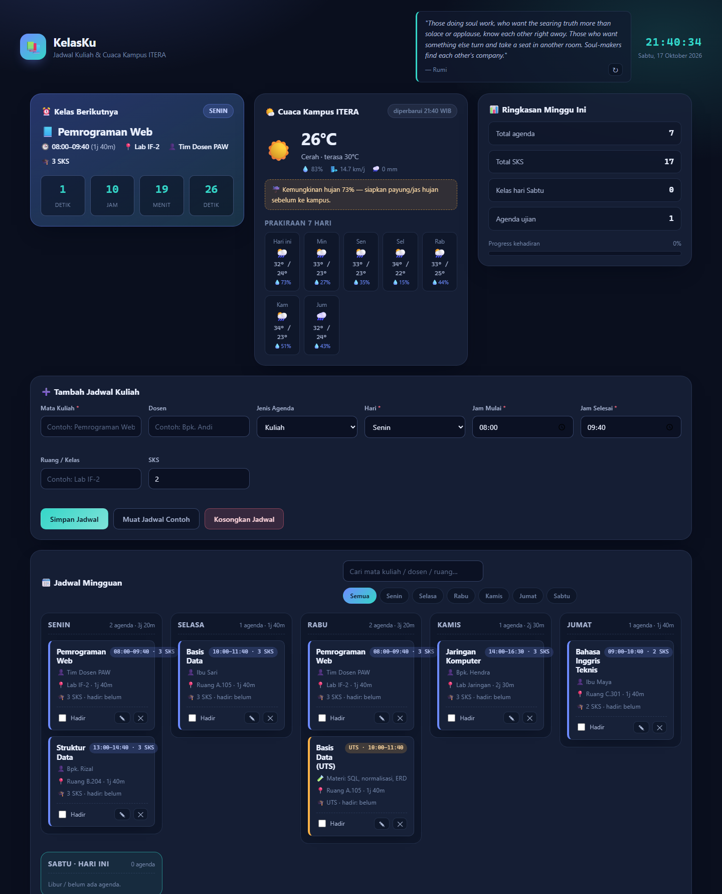
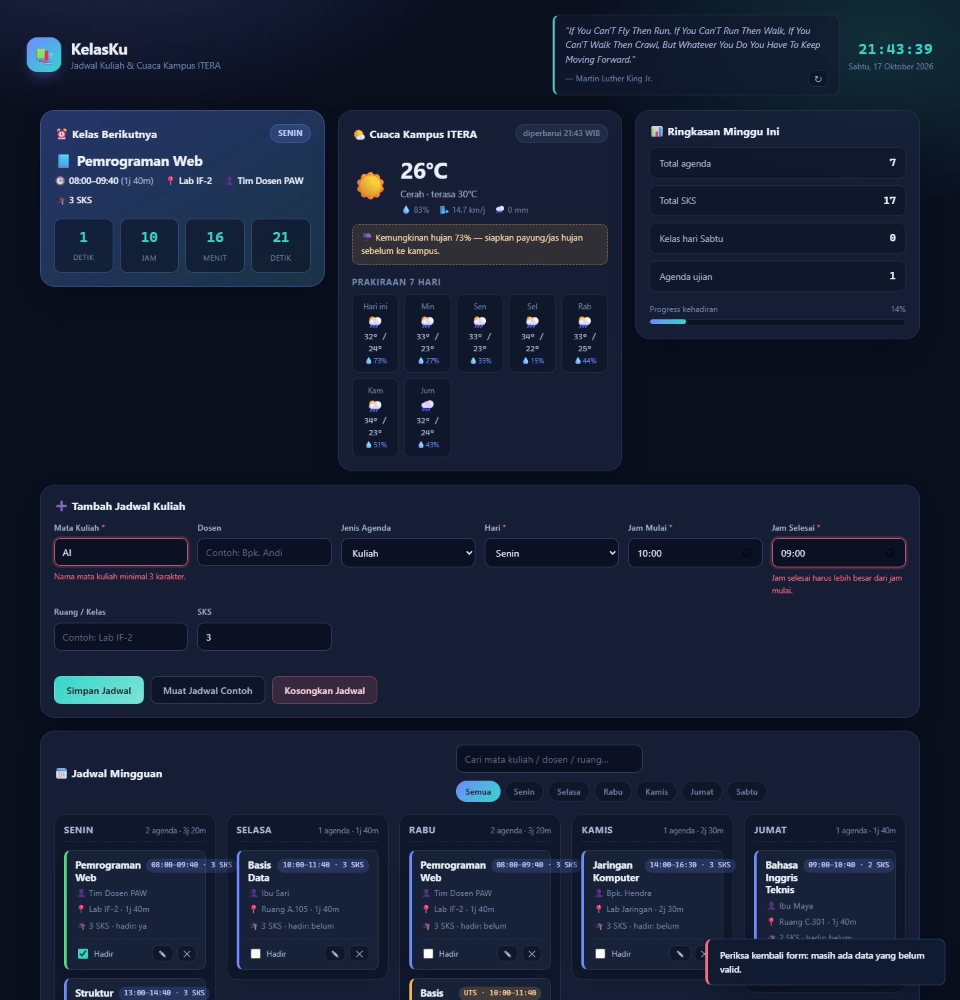
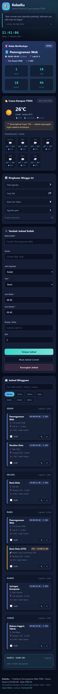

# KelasKu — Dashboard Jadwal Kuliah & Cuaca Kampus ITERA

## Identitas

- Nama: Yowen Daniel
- NIM: 124140120
- Kelas: PAW RA
- Tema tugas: **Tantangan Kreatif — aplikasi yang membantu produktivitas mahasiswa sehari-hari**

---

## Deskripsi Aplikasi

**KelasKu** adalah aplikasi web sederhana berbentuk *dashboard* yang membantu mahasiswa mengelola jadwal kuliah mingguan, melihat **kelas berikutnya beserta hitungan waktu mundur (countdown)**, memantau **cuaca terkini dan prakiraan 7 hari di Kampus ITERA (Lampung Selatan)**, serta mendapatkan **kutipan motivasi harian**.

Latar belakang pemilihan tema: sebagai mahasiswa, kebutuhan yang paling sering muncul setiap hari adalah *"kelas apa berikutnya, jam berapa, di ruang mana, dan apakah perlu bawa payung?"*. Aplikasi ini menjawab pertanyaan tersebut dalam satu halaman, sekaligus mencatat kehadiran kelas sebagai bahan evaluasi pribadi.

Dibuat dengan **HTML5, CSS3, dan JavaScript Vanilla (ES6+)** tanpa framework, tanpa build tool, dan tanpa API key. Cuaca dan kutipan diambil secara *asinkron* (`fetch()` + `async/await`) dari API publik gratis.

---

## Fitur

### Pengelolaan jadwal (CRUD penuh)

- [x] Tambah jadwal kuliah: mata kuliah, dosen, hari, jam mulai, jam selesai, ruang, SKS
- [x] Tambah agenda ujian (UTS/UAS/Kuis) beserta materi yang diujikan
- [x] Ubah/edit jadwal (tombol ✎ pada kartu) dengan mode edit yang jelas
- [x] Hapus jadwal dengan konfirmasi
- [x] Tandai **kehadiran** per kelas (checkbox) + progress kehadiran dalam persen
- [x] Tombol **Muat Jadwal Contoh** dan **Kosongkan Jadwal**

### Interaktivitas & informasi

- [x] Kartu **Kelas Berikutnya** dengan countdown *live* (hari/jam/menit/detik, diperbarui tiap detik)
- [x] Status otomatis: **"sedang berlangsung"** saat kelas sedang berjalan, "Hari ini", atau "Besok"
- [x] Grid jadwal mingguan Senin–Sabtu, kolom **hari ini** otomatis di-highlight
- [x] Filter per hari + pencarian *live* berdasarkan mata kuliah/dosen/ruang
- [x] Ringkasan: total agenda, total SKS, kelas hari ini, dan jumlah agenda ujian
- [x] Widget **cuaca Kampus ITERA** + prakiraan 7 hari + saran "bawa payung / aman"
- [x] Kutipan motivasi harian dari DummyJSON (bisa ganti kutipan lain)
- [x] Jam & tanggal *real-time* zona Asia/Jakarta
- [x] Pesan notifikasi (*toast*) untuk setiap aksi berhasil/gagal

### Validasi & ketahanan data

- [x] Validasi JavaScript: nama mata kuliah minimal 3 karakter, jam selesai > jam mulai, durasi minimal 40 menit, SKS 1–6
- [x] **Deteksi jadwal bentrok** pada hari & jam yang sama
- [x] Pesan error tampil tepat di bawah field yang salah (teks merah + garis merah)
- [x] Seluruh state otomatis tersimpan di `localStorage` (anti *refresh*)
- [x] Cache hasil API di `localStorage` agar hemat kuota dan tetap tampil saat offline
- [x] Desain responsif (grid otomatis) — diuji pada lebar layar HP 390px tanpa *scroll* horizontal
- [x] Aksesibilitas dasar: `label`/`for`, atribut `aria-*`, `aria-live` untuk toast, dukungan `prefers-reduced-motion`

---

## Screenshot

### 1. Tampilan utama dashboard (desktop)



### 2. Validasi form (data tidak valid + progress kehadiran)



### 3. Tampilan pada layar HP



---

## Struktur Folder

```
YowenDaniel_124140120_pertemuan2/
│
├── index.html                     ← struktur halaman (semantic HTML5 + <template>)
├── style.css                      ← desain UI/UX (CSS variables, grid, dark mode)
├── script.js                      ← seluruh logika aplikasi (OOP + ES6+ + localStorage + fetch)
├── README.md                      ← dokumentasi (file ini)
│
├── screenshot-dashboard.png       ← screenshot tampilan utama
├── screenshot-validasi.png        ← screenshot pesan validasi & progress kehadiran
├── screenshot-mobile.png          ← screenshot tampilan HP (390px)
│
└── modul/
    └── README.md                  ← keterangan folder modul + pemetaan kompetensi
```

---

## Panduan Menjalankan

1. Unduh/*clone* repositori ini.
2. Buka folder `YowenDaniel_124140120_pertemuan2` di VS Code.
3. Jalankan `index.html` dengan **Live Server** (klik kanan → *Open with Live Server*).
4. Browser akan terbuka dan mengisi jadwal contoh secara otomatis pada kunjungan pertama.

Aplikasi juga bisa dibuka langsung dengan **klik dua kali `index.html`** (tidak memerlukan server/backend). Karena proyek ini sengaja tidak memakai ES Module (`import`/`export`), semua fitur tetap berjalan dari protokol `file://`.

Saat pertama dibuka, aplikasi langsung diisi **7 agenda contoh** (6 kuliah + 1 UTS) agar tampilan tidak kosong. Data contoh dapat diganti atau dihapus kapan saja.

---

## Arsitektur Kode

Kode ditulis dengan pola *Object-Oriented* modern sesuai panduan: satu kelas model item, satu kelas pengelola dashboard, dan penyimpanan data di `localStorage`.

```
AgendaItem  (class dasar, script.js:116)
│   id, title, day, start, end, room, type, attended
│   getter: startMinutes, durationMinutes, timeRange, isExam …
│   static: createId(), fromJSON()
│
├── CourseItem extends AgendaItem   (script.js:193)  → + lecturer, sks
└── ExamItem   extends AgendaItem   (script.js:205)  → + kind (UTS/UAS/Kuis), material

DashboardApp (class pengelola, script.js:224)
    #courses (state)  ──┬── loadFromStorage() / save()      → localStorage
                        ├── addCourse() / updateCourse() / deleteCourse() / toggleAttendance()
                        ├── findNextAgenda() / getSummary() / getFilteredCourses()
                        ├── renderSemuaBagian()             → DOM (index.html)
                        └── loadWeather() / loadQuote()     → fetch() API publik
```

**Alur data:** form → `validateForm()` → `addCourse()` (objek baru dari `AgendaItem.fromJSON()`) → `save()` ke `localStorage` → `renderAll()` memperbarui DOM. Saat halaman dibuka: `loadFromStorage()` → `renderAll()` → `loadWeather()` & `loadQuote()` dijalankan paralel, lalu countdown diperbarui tiap detik.

Pemisahan tanggung jawab: `index.html` hanya berisi struktur, `style.css` hanya tampilan, dan `script.js` hanya logika — tidak ada JavaScript di dalam HTML.

---

## Daftar Fitur ES6+ yang Diimplementasikan

Semua lokasi di bawah merujuk pada file **`script.js`** kecuali disebutkan lain.

| No | Fitur ES6+ | Lokasi (baris) | Keterangan |
|----|-----------|----------------|------------|
| 1 | `const` / `let` (block scope) | 13, 33, 36, 60–99 | Konfigurasi dan helper memakai `const`; tidak ada `var`. |
| 2 | **Class** | 116 (`AgendaItem`), 224 (`DashboardApp`) | Model data dan pengelola aplikasi berbentuk kelas. |
| 3 | **Inheritance + `super()`** | 193–203 (`CourseItem`), 205–219 (`ExamItem`) | Keduanya `extends AgendaItem` dan memanggil `super(...)`. |
| 4 | **Getter** | 151–186, 200, 212, 216 | `durationLabel`, `timeRange`, `badgeLabel` (di-*override* tiap subclass), `displayTitle`. |
| 5 | **Static method** | 140 (`createId`), 145 (`fromJSON`), 302 (`demoSchedule`) | `fromJSON()` bertindak sebagai *factory*: memilih `CourseItem` atau `ExamItem` dari data `localStorage`. |
| 6 | **Private class field & private method** | 225–228 (`#courses`, `#editingId`, `#activeDay`), 236 (`#collectElements`), 610 (`#buildCourseCard`), 683 (`#readForm`), 871 (`#bindEvents`) | State tidak bisa diubah dari luar kelas. |
| 7 | **Default parameter** | 63, 145, 194, 206, 230, 321, 503, 550, 689, 773 | Contoh: `toMinutes = (time = '00:00') => …`. |
| 8 | **Destructuring objek** | 194, 206, 366, 385, 522, 612, 854 | Di parameter fungsi: `constructor({ lecturer = 'Belum diisi', sks = 2, ...rest } = {})`. |
| 9 | **Destructuring array** | 64, 98, 686 | `const [jam, menit] = time.split(':').map(Number)`. |
| 10 | **Rest parameter** | 194, 206, 385, 393 | `const { type, ...rest } = formValues;` memisahkan field `type` dari sisanya. |
| 11 | **Spread operator** | 189, 195, 207, 322, 387, 394, 410, 599 | `this.#courses = [...this.#courses, course]` → array state selalu *immutable*. |
| 12 | **Template literal** (termasuk bersarang) | 72, 201, 213, 217, 495, 525, 562, 588, 649 | `return `${jam > 0 ? `${jam}j ` : ''}${menit}m`;` (baris 72) serta pewarnaan kartu jadwal (649). |
| 13 | **Arrow function** | 60, 63, 69, 76, 97, 322, 329, 346, 562, 874 | Dipakai untuk helper dan *callback*. |
| 14 | **Higher-order array method** (`map`, `filter`, `find`, `reduce`, `some`, `sort`) | 289, 322, 329, 346, 366, 394, 401, 411, 421, 430, 648 | `reduce` menghitung agenda terdekat (346) dan ringkasan SKS (366). |
| 15 | **Optional chaining `?.`** | 522, 538, 546, 612, 618 | `data?.daily?.precipitation_probability_max?.[0] ?? 0`. |
| 16 | **Nullish coalescing `??`** | 101, 333, 421, 522, 563, 692, 750–758, 796 | `errors[fieldName] ?? ''`. |
| 17 | **`async` / `await` + `fetch`** | 803 (`loadWeather`), 814–828, 841 (`loadQuote`), 854 | Mengambil data Open-Meteo dan DummyJSON. |
| 18 | **`Promise.allSettled`** | 946 | Cuaca + kutipan diambil **paralel** saat aplikasi dimulai. |
| 19 | **`try` / `catch`** (error handling) | 281–293, 787–798, 813–838, 851–861 | Bila API gagal, aplikasi menampilkan cache lama, bukan layar rusak. |
| 20 | **`Map`** | 36–54 | `WEATHER_CODES` memetakan kode cuaca WMO → ikon + label Bahasa Indonesia. |
| 21 | **`Object.freeze`** | 13, 18, 24, 33 | `CONFIG` dan isinya tidak bisa diubah saat runtime. |
| 22 | **`Object.entries` / `Object.fromEntries`** | 823, 686 | Membaca nilai form: `Object.fromEntries([...data.entries()].map(…))`. |
| 23 | **`Intl.DateTimeFormat`** (Internationalization API) | 86–87, 460–466, 558–559 | Nama hari/tanggal format Indonesia + kunci zona waktu Asia/Jakarta. |
| 24 | **`String.padStart`** | 514–516 | Countdown ditampilkan 2 digit: `String(hours).padStart(2, '0')`. |
| 25 | **`URL` + `URLSearchParams`** | 814–823 | Menyusun *query string* Open-Meteo secara aman. |
| 26 | **Computed property name** | 797 | `{ ...meta, [key]: payload }` saat menulis cache. |
| 27 | **`<template>` + `DocumentFragment` + `replaceChildren`** | 636, 641, 661, 670 (dan `index.html`) | Kartu jadwal dibuat dari satu template, dirender sekali gus tanpa *reflow* berulang. |
| 28 | **Event delegation** (`addEventListener` + `closest`) | 874–936 (khususnya 902, 913, 916, 930) | Satu *listener* di grid menangani klik edit/hapus & checkbox semua kartu. |

---

## Pengelolaan Data dengan localStorage

| Key | Isi | Kapan ditulis |
|-----|-----|---------------|
| `kelasKu.schedule.v1` | Array seluruh agenda jadwal | Setiap kali tambah/ubah/hapus/tandai kehadiran |
| `kelasKu.meta.v1` | Cache `weather` (±30 menit) dan `quote` (±60 menit) | Setelah `fetch()` berhasil |

**Alur penyimpanan:**

1. Setiap model memiliki `toJSON()` (`script.js:188`) → `return { ...this }` sehingga untung-rugi `getter` (nilai turunan) tidak ikut tersimpan.
2. `save()` (`script.js:297`) menjalankan `JSON.stringify()` → `localStorage.setItem()`.
3. Saat halaman dimuat, `loadFromStorage()` (`script.js:280`) menjalankan `JSON.parse()` lalu memetakan tiap objek dengan `AgendaItem.fromJSON()` supaya **tipe kelas aslinya kembali** (`CourseItem` tetap `CourseItem`, `ExamItem` tetap `ExamItem`), bukan objek polos.
4. Jika `localStorage` masih kosong, aplikasi mengisi 7 agenda contoh melalui `DashboardApp.demoSchedule()`.

Contoh isi `kelasKu.schedule.v1`:

```json
[
  {
    "id": "agenda-mf3k9x-8zt1p",
    "title": "Pemrograman Web",
    "day": "Senin",
    "start": "08:00",
    "end": "09:40",
    "room": "Lab IF-2",
    "type": "kuliah",
    "attended": false,
    "createdAt": 1760700000000,
    "lecturer": "Tim Dosen PAW",
    "sks": 3
  },
  {
    "id": "agenda-mf3k9x-4ld2q",
    "title": "Basis Data",
    "day": "Rabu",
    "start": "10:00",
    "end": "11:40",
    "room": "Ruang A.105",
    "type": "ujian",
    "attended": false,
    "createdAt": 1760700000000,
    "kind": "UTS",
    "material": "SQL, normalisasi, ERD"
  }
]
```

---

## Integrasi API Publik (Asinkron)

| Sumber | Endpoint | Data yang dipakai |
|--------|----------|-------------------|
| **Open-Meteo** (tanpa API key) | `https://api.open-meteo.com/v1/forecast?latitude=-5.36&longitude=105.31&current=temperature_2m,relative_humidity_2m,apparent_temperature,precipitation,weather_code,wind_speed_10m&daily=weather_code,temperature_2m_max,temperature_2m_min,precipitation_probability_max&timezone=Asia/Jakarta&forecast_days=7` | Suhu, kelembapan, angin, peluang hujan, prakiraan 7 hari untuk koordinat Kampus ITERA (−5.36, 105.31). |
| **DummyJSON Quotes** | `https://dummyjson.com/quotes/random` | Kutipan + nama penulis untuk header dashboard (*Inspirasi & Kutipan Harian*). |

Detail implementasi:

- `loadWeather()` (`script.js:803`) dan `loadQuote()` (`script.js:841`) adalah `async` function dengan blok `try/catch`.
- Keduanya dijalankan **bersamaan** menggunakan `Promise.allSettled([...])` (`script.js:946`) sehingga aplikasi tidak menunggu satu per satu.
- **Cache**: hasil disimpan di `localStorage` (`kelasKu.meta.v1`). Cuaca dipakai ulang maksimal 30 menit, kutipan 60 menit; ada tombol **↻** untuk memaksa kutipan baru.
- **Fallback**: bila jaringan mati, data cache lama tetap ditampilkan dan label berubah menjadi `cache lama (offline)`. Kalau cache pun tidak ada, muncul pesan ramah di kartu cuaca, bukan error di console saja.
- Kode cuaca WMO (mis. `0`, `61`, `95`) diterjemahkan ke Bahasa Indonesia lewat `Map` `WEATHER_CODES` (`script.js:36`).

---

## Validasi & Aturan Bisnis

| Aturan | Lokasi | Perilaku |
|--------|--------|----------|
| Mata kuliah wajib, 3–60 karakter | `script.js:429` | Error di bawah field `title`, form tidak di-reset |
| Hari harus Senin–Sabtu | `script.js:431` | Error di bawah field `day` |
| Jam selesai harus lebih besar dari jam mulai | `script.js:433` | Error di bawah field `end` |
| Durasi minimal 40 menit | `script.js:435` | Error di bawah field `end` |
| SKS 1–6 (khusus jenis "Kuliah") | `script.js:439` | Field SKS disembunyikan saat jenis agenda = Ujian (`script.js:715`) |
| **Deteksi jadwal bentrok** | `script.js:443` | Menolak jadwal yang jamnya bertabrakan di hari yang sama dan menampilkan nama mata kuliah yang bentrok |
| Konfirmasi hapus | `script.js:890`, `script.js:918` | `window.confirm()` sebelum menghapus data |

Semua teks dari pengguna disanitasi dengan `escapeHtml()` (`script.js:76`) sebelum dimasukkan ke `innerHTML`, agar aman dari injeksi HTML.

---

## Pemetaan ke Kriteria Penilaian

| Aspek | Bobot | Implementasi |
|-------|-------|--------------|
| Fungsionalitas & interaktivitas aplikasi | 30% | CRUD lengkap (tambah/edit/hapus/tandai hadir), filter hari, pencarian, countdown *live*, deteksi bentrok, widget cuaca, kutipan, toast, ringkasan statistik |
| Implementasi fitur ES6+ | 25% | 28 poin ES6+ pada tabel di atas: class + inheritance, getter/static, private field, destructuring, rest/spread, template literal, `Map`, `?.`/`??`, `async/await`, `Promise.allSettled`, `Intl`, dsb. |
| Penggunaan localStorage & pengelolaan data | 20% | Dua key (`kelasKu.schedule.v1`, `kelasKu.meta.v1`), `JSON.stringify/parse`, *factory* `fromJSON()` untuk memulihkan tipe kelas, cache API ber-TTL, fallback offline |
| Desain UI dan UX | 15% | Dashboard gelap modern (CSS variables), kartu-kartu informatif, kolom "hari ini" di-highlight, countdown besar, ikon cuaca, toast, responsif sampai 390px, `prefers-reduced-motion` |
| Dokumentasi dan kerapian kode | 10% | README ini + `modul/README.md`, kode berkomentar & terbagi 5 bagian bernomor, penamaan konsisten, HTML/CSS/JS terpisah |

---

## Pengujian yang Dilakukan

Pengujian dijalankan otomatis memakai Chrome *headless* (termasuk simulasi lebar layar HP 390px) dengan hasil sebagai berikut:

| Skenario | Hasil |
|----------|-------|
| Aplikasi memuat tanpa error console | ✅ hanya log `KelasKu siap ✅` |
| Data contoh terisi otomatis saat pertama dibuka | ✅ 7 agenda |
| Tambah agenda valid | ✅ tersimpan & langsung tampil |
| Tambah agenda tidak valid (judul < 3 karakter, jam terbalik) | ✅ ditolak + pesan error tepat di bawah field |
| Jadwal bentrok pada hari & jam yang sama | ✅ ditolak dengan pesan `Bentrok dengan Basis Data (10:00–11:40)`. |
| Agenda jenis Ujian memakai kelas `ExamItem` | ✅ badge `UAS · 13:00–14:40` |
| Edit jadwal | ✅ data berubah, tipe kelas tetap `CourseItem` |
| Tandai kehadiran | ✅ tersimpan, progress naik (0% → 13%) |
| Hapus jadwal | ✅ jumlah berkurang dan `localStorage` ikut diperbarui |
| *Round-trip* localStorage | ✅ objek hasil `JSON.parse()` + `fromJSON()` kembali menjadi instance `AgendaItem` dengan seluruh 11 field |
| Pencarian "basis" & filter hari "Rabu" | ✅ masing-masing menampilkan 2 kartu yang sesuai |
| Ringkasan (total, SKS, ujian, progress) | ✅ sesuai data (mis. 8 agenda, 17 SKS, 2 ujian, 13%) |
| Fetch cuaca Open-Meteo | ✅ data nyata (mis. 26 °C, cerah) + prakiraan 7 hari |
| Fetch kutipan DummyJSON | ✅ kutipan + penulis tampil |
| Tampilan HP 390px | ✅ `scrollWidth` = `clientWidth` = 390px (tidak ada *scroll* horizontal) |

---

## Catatan Teknis

- **Tanpa framework dan tanpa build step** agar mudah diperiksa dosen: cukup tiga file (`index.html`, `style.css`, `script.js`).
- **Sengaja tidak memakai ES Module** (`import`/`export`) supaya aplikasi tetap jalan saat dibuka langsung dari `file://` (klik dua kali), tidak hanya lewat Live Server.
- **Zona waktu** dihitung dengan `Intl.DateTimeFormat` bertema `Asia/Jakarta`, jadi jam, tanggal, countdown, dan penanda "hari ini" tetap benar meskipun jam perangkat pengguna bukan WIB.
- **Latitude/longitude Kampus ITERA** (−5.36, 105.31) disimpan di `CONFIG.campus` sehingga bisa diganti ke lokasi lain dengan satu baris perubahan.
- Ikon memakai *emoji* dan simbol Unicode sederhana agar tidak perlu aset gambar tambahan.
